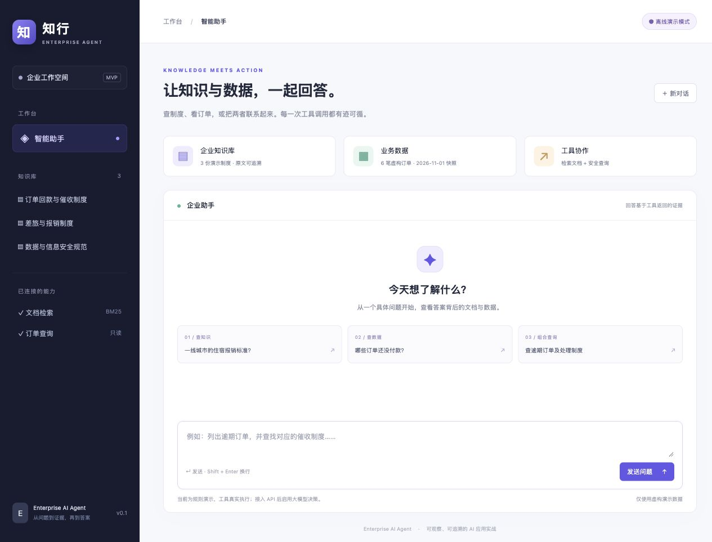
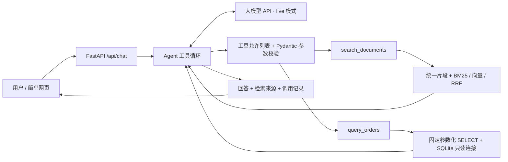
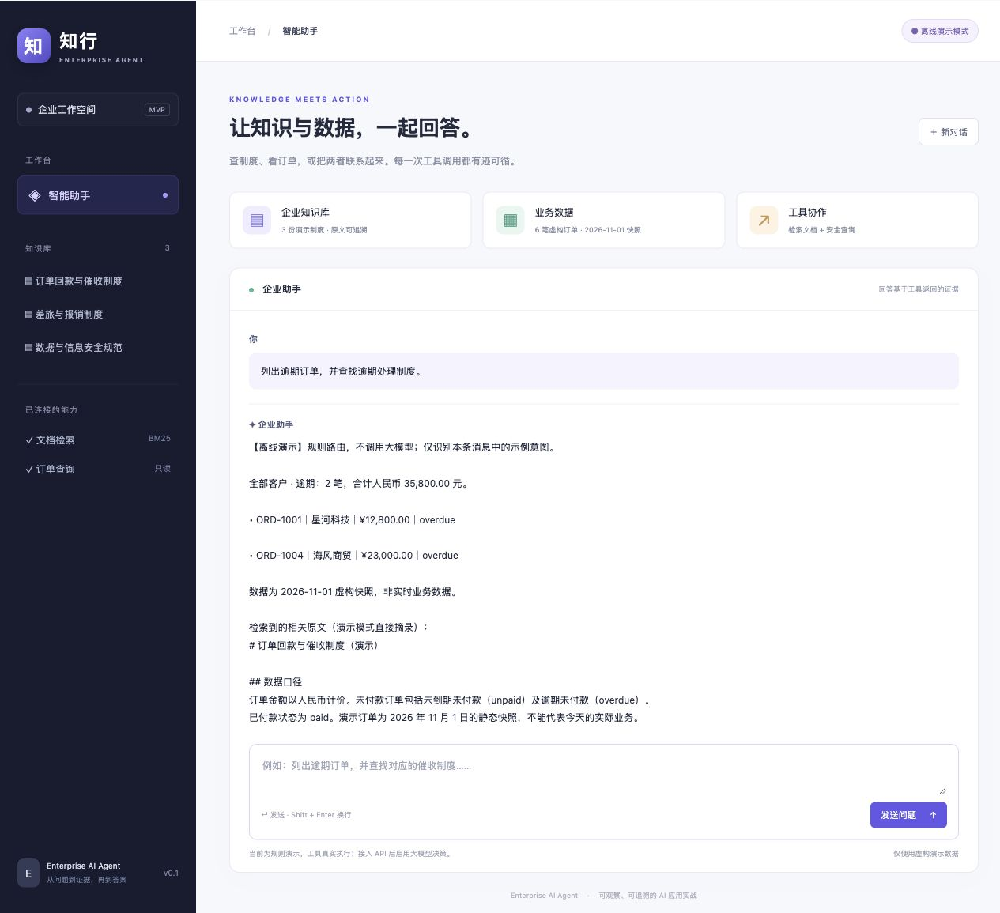

# 知行 · Enterprise AI Agent

[](https://github.com/Kerwinzs/Enterprise-Agent/actions/workflows/ci.yml)


一个面向 **AI 应用开发 / Agent 工程师**学习与作品展示的企业助手 MVP。
用户用自然语言查制度、查订单，助手通过工具获取证据，展示回答、检索来源与调用记录。



> 默认离线演示：规则决定调用哪些工具，文档检索和数据库查询真实执行。
> 配置 `AGENT_MODE=live` 与 API 密钥后，才由真实大模型进行 function calling。
> 这是本地学习项目，所有制度和订单均为虚构数据。

## 能做什么

| 场景 | 示例 | 执行路径 |
| --- | --- | --- |
| RAG 知识库问答 | 一线城市出差住宿报销标准是多少？ | 检索片段 → 根据原文回答 → 标注引用 |
| 业务查询 | 有哪些未付款订单？总金额是多少？ | 模型生成结构化参数 → 只读订单工具 → 汇总回答 |
| 组合查询 | 列出逾期订单，并查找逾期处理制度 | 分别调用订单工具和文档工具 → 综合回答 |
| 查看依据 | 展开调用记录、点击检索来源 | 查看真实参数、返回结果、耗时和完整原文 |

支持 **BM25 关键词检索、中文向量检索、RRF 混合检索**，三种模式共用相同文档片段。
默认 BM25 无需下载模型；可选本地中文模型在 CPU 上完成语义检索，文档向量缓存到本机。
当前使用小规模精确扫描，没有引入向量数据库或重排序模型。
没有引入 LangChain、LangGraph 等编排框架，工具循环可以直接读懂。

## 技术栈与架构

- Python 3.11+、FastAPI、Pydantic / pydantic-settings。
- HTTPX 调用 OpenAI-compatible Chat Completions API。
- SQLite 存储演示订单，金额使用整数“分”。
- 可选 FastEmbed / ONNX 中文 embedding、余弦相似度及 RRF 排名融合。
- 原生 HTML / CSS / JavaScript，同源部署，无 Node 构建步骤、无前端密钥。
- pytest、Ruff、GitHub Actions。



真实模式执行过程：

1. 将系统提示词、有限历史和问题发给模型，同时提供工具 JSON schema。
2. 模型返回工具名称和 JSON 参数；后端校验并执行允许的函数。
3. 将真实结果作为 `role=tool` 消息回传，保留对应 `tool_call_id`。
4. 模型继续调用工具或给出最终答案。限制轮数、总调用数和处理时间。

离线模式仅替换“决策与总结”部分，共用实际检索、数据库工具与响应结构。

## 五分钟启动（macOS / Linux）

```bash
git clone https://github.com/Kerwinzs/Enterprise-Agent.git enterprise-ai-agent
cd enterprise-ai-agent
python3 -m venv .venv
source .venv/bin/activate
python -m pip install -r requirements.lock
cp .env.example .env
python -m uvicorn app.main:app --host 127.0.0.1 --port 8000
```

打开 [项目网页](http://127.0.0.1:8000)。默认 `demo` 模式无需 API 密钥，无需下载模型。
首次启动自动在 `.local/orders.db` 创建 6 笔演示订单，并读取 33 份 Markdown 制度。

`requirements.lock` 固定本次验证的运行和开发依赖；如需更新兼容版本，可改用
`python -m pip install -e ".[dev]"`。`requirements.txt` 提供仅安装应用的入口：
`python -m pip install -r requirements.txt`。

若 8000 端口被占用，把启动命令的 `--port 8000` 改为 `--port 8001`，浏览器同步更改。
按 Ctrl+C 停止服务。


## 检索优化：从漏检到实测对比

“住酒店最多能报多少钱？”在原版 BM25 中漏检。
本次加入中文向量召回、RRF 融合和内容/模型指纹缓存，支持三种模式切换，
保留 33 个片段与 60 条带原文证据的问题用于复现。

| 检索方式 | Hit@1 | Recall@3 | 检索 P95 |
| --- | ---: | ---: | ---: |
| BM25 | 65% | 75% | 0.260 ms |
| 纯向量 dense | 90% | 95% | 8.574 ms |
| 混合 hybrid | 75% | 87.5% | 8.882 ms |

以上是 50 条固定测试问题中 **40 条有答案问题**的本地真实结果。
其余 10 条无答案单独统计，未混入 Recall 分母；另有 10 条 dev 问题。
这是小型合成回归集，不是盲测、生产性能或完整问答准确率。
混合优于关键词基线，但本次纯向量更强，不预设新增技术一定更好。

详细记录见 **[优化过程、原理与面试讲解线](docs/RETRIEVAL_OPTIMIZATION.md)**，
包括失败案例、取舍、一分钟口述、简历表述及 [逐题原始报告](docs/retrieval_results.json)。

启用向量或混合模式（锁定依赖在 Python 3.12 验证）：

~~~bash
python -m pip install -r requirements-retrieval.lock
python -m scripts.prepare_retrieval
~~~

prepare 首次联网下载约 95 MB 模型并建立文档向量缓存；之后服务只读本地模型。
在 .env 设置 RETRIEVAL_MODE=hybrid，重启服务即可。
也可以设 dense 试用本次样本中效果更好的纯向量，或 bm25 回到免模型模式。
检索模式与 AGENT_MODE 独立：demo 也能使用真实本地 embedding，live 仍需大模型密钥。
Python 3.11 用户可通过 python -m pip install -e ".[retrieval]" 安装兼容依赖版本；
提供的可选精确锁文件使用了仅支持 Python 3.12+ 的 NumPy 版本。

运行相同评测：

~~~bash
python -m scripts.evaluate_retrieval --split dev --output benchmarks/dev_results.json --repeats 3
python -m scripts.evaluate_retrieval --split test --output docs/retrieval_results.json --repeats 5
~~~

没有本地模型也可用 --modes bm25 单独测基线。
缓存会校验文档、模型和版本指纹。缺模型的 dense / hybrid 模式会在启动时提示模型准备步骤。

### 检索证据门槛

向量搜索总会从已有片段中选出近邻。启用门槛后，dense 和 hybrid 先检查最高余弦相似度。
分数低于门槛时，工具返回空候选，演示模式提示资料不足。混合模式在 RRF 排名融合前执行检查。
相似度阈值随语料和模型变化，可根据实际分布校准。[BGE 模型说明](https://huggingface.co/BAAI/bge-small-zh-v1.5#frequently-asked-questions)

在 32 条校准问题上取能保留全部 18 条有答案问题的最高两位小数阈值，得到 **0.47**。
随后在原有 50 条合成测试问题上运行前后对比。两种向量模式均将无答案问题的候选返回数从
10 条降至 7 条，同时错拦 40 条有答案问题中的 1 条。错拦样例是询问六千元采购审批人的口语问法。

| 检索方式 | 无答案问题返回候选 | 有答案问题 Recall@3 |
| --- | ---: | ---: |
| dense | 10/10 → 7/10 | 95% → 92.5% |
| hybrid | 10/10 → 7/10 | 87.5% → 85% |

在 `.env` 中将 `RETRIEVAL_MODE` 设为 `dense` 或 `hybrid`，添加
`RETRIEVAL_MIN_DENSE_SCORE=0.47` 后重启。工具调用记录会显示生效阈值。

~~~bash
python -m scripts.evaluate_evidence_gate
~~~

脚本使用本地模型，先在开发样本上校准，再测固定测试集。
[新增校准样本](benchmarks/evidence_gate_calibration.json) · [逐题评测结果](benchmarks/evidence_gate_results.json)

## 接入真实大模型

只在本机 `.env` 中修改：

```dotenv
AGENT_MODE=live
OPENAI_API_KEY=替换为你自己的API密钥
OPENAI_BASE_URL=https://api.openai.com/v1
OPENAI_MODEL=gpt-4.1-mini
```

重启后端，网页右上角应显示“大模型模式”。示例模型名不是可用性承诺，
请使用你账户已开通、支持 Chat Completions function calling 的模型。
兼容服务可替换基础地址与模型，但需要支持 `tools`、`tool_choice`、
严格 JSON schema 和工具结果消息；兼容程度需要实际验证。

密钥留在后端，浏览器无法配置或获取它。API 请求会发送问题、所选历史和工具结果给配置的供应商；
使用前应确认其数据政策。本项目发送 `store=false`，这不等于供应商零留存承诺。
live 缺密钥返回 503，供应商错误返回 502，处理超时返回 504；不会自动改为离线答案。

**验证边界：** 离线完整链路和模拟供应商 HTTP 响应的 live 工具循环已通过自动测试。
创建项目时没有真实模型密钥，未验证线上供应商调用成功率和生成质量。

## 演示脚本

在网页依次提问：

1. **一线城市出差住宿报销标准是多少？**
   - 应检索 `reimbursement` 文档，原文规定一线城市住宿每晚不超过 600 元。
   - demo 展示候选原文供核对；live 由大模型总结，引用如 `[reimbursement:1]`。
2. **有哪些未付款订单？总金额是多少？**
   - 未付款包含 unpaid 和 overdue，共 4 笔，合计 **54,350.00 元**。
3. **列出逾期订单，并查找逾期处理制度。**
   - 应执行两个工具；逾期 2 笔，合计 **35,800.00 元**，找到催收制度原文。
4. 展开“工具调用”，查看参数和结果；点击“检索来源”核对原文。

订单状态来自 **2026-11-01 静态快照**，不会随今天日期自动变化。
汇总字段覆盖所有匹配订单，列表最多 50 行，并返回 `truncated`，避免把截断列表当作总量。



## API

| 方法 | 地址 | 用途 |
| --- | --- | --- |
| GET | `/health` | 进程健康和模式，不代表上游模型可用 |
| GET | `/api/config` | 模式、模型名、密钥是否配置、工具列表 |
| GET | `/api/documents` | 已注册的知识文档 |
| GET | `/api/documents/{id}` | 文档原文，不接受任意文件路径 |
| POST | `/api/chat` | 单次 Agent 请求 |
| GET | `/docs` | FastAPI 交互文档（需要访问 Swagger CDN） |

```bash
curl http://127.0.0.1:8000/api/chat \
  -H 'Content-Type: application/json' \
  -d '{"message":"有哪些未付款订单？总金额是多少？","history":[]}'
```

核心响应字段为 `answer`、`mode`、`sources`、`tool_calls`、
`elapsed_ms` 和 `request_id`。`sources` 是本轮检索候选来源，不保证每条都被答案引用。
调用记录是工具输入输出，**不是模型隐藏推理**。

接口无服务端会话；前端在内存中保留最多 12 条历史，新对话或刷新后清空。
demo 只路由当前输入中的示例关键词，不理解任意复杂条件与上下文；
live 会接收历史，但需要通过本轮工具重新获取业务证据。

## 测试与代码检查

```bash
source .venv/bin/activate
python -m pytest -q
ruff check .
ruff format --check .
```

覆盖检索命中与无结果、客户精确匹配、未回款口径与全量汇总、SQL 注入输入、
只读连接、非法工具和参数、API 输入边界、真实工具执行、
模拟 HTTP 供应商的多工具往返、错误脱敏、调用预算与超时。
测试无需密钥，不产生模型费用。当前 61 项测试覆盖原能力及 RRF、检索证据门槛、向量缓存失效/损坏、
向量合法性、评测指标口径、显式下载边界和混合检索的实际工具路径。
默认单元测试使用测试编码器，不下载模型；效果报告由本机真实 BGE 模型生成。
GitHub Actions 在 Python 3.11 / 3.12 检查基础依赖，另在 3.12 验证可选向量依赖。

## 代码导航

```text
app/
  main.py          # FastAPI 路由、资源生命周期、错误映射和请求上限
  agent.py         # 真实工具调用循环、提示词、离线演示规划器
  llm.py           # 大模型 HTTP 协议、响应解析、安全错误
  tools.py         # 工具定义、允许列表、Pydantic 参数校验
  retrieval.py     # 统一切分、BM25 与 RRF 融合
  embeddings.py    # 可选中文模型适配器，默认禁止下载
  vector_index.py  # 文档向量缓存、指纹校验、精确余弦搜索
  database.py      # 演示初始化、参数化只读订单查询
  config.py        # 环境配置、密钥类型与 API 地址校验
  schemas.py       # 接口和调用记录模型
  sample_data/     # 虚构订单与 Markdown 制度
  static/          # 网页、样式、浏览器交互
tests/             # 工具和 API 集成测试
scripts/           # 显式准备模型、运行三路检索评测
benchmarks/        # 固定问题标签、开发集结果与评测约定
docs/              # 演示截图、优化过程、原始报告和学习指南
.github/workflows/ # CI
```

增改文档后重启，BM25 重建内存索引，向量模式根据新指纹重新生成文档向量。
旧缓存保留在 .local/vectors；有需要可在停止服务后清理不再使用的缓存。
订单初始化仅补充缺失的订单 ID，不覆盖已有行；若修改演示种子，先停止服务，
备份或移走 `.local/orders.db` 后重启。不要将真实公司数据放进公开仓库。

## 权限与当前限制

- 工具允许列表、参数 schema、固定查询和只读连接共同控制能力；模型不接触任意 SQL、
  Shell、写库或发送消息工具。
- 密钥用 `SecretStr` 管理，`.env`、虚拟环境和本地数据库被 Git 忽略。上游错误体不返给前端。
- 输入长度、历史数量、工具结果数量、最大轮数、总调用数、总耗时与每进程 4 个活跃请求均有界。
- 网页采用文本渲染模型输出，避免把回答当作 HTML 执行。
- 提示词要求忽略文档中的指令，但这不能证明防住所有提示注入；可疑文档仍需审查。
- 引用 ID 会与本轮检索结果核对，**不代表已自动验证结论与引用语义一致**。
- 支持 Markdown、BM25 / 本地向量 / 混合检索和状态/客户精确匹配。
  尚无 PDF 上传、向量数据库、日期筛选、reranker 和流式回复。
- 本地 MVP 没有登录、租户隔离或持久审计；当前只应绑定本机地址。
  公开部署前需要补充身份认证、授权、按用户限流、数据隔离与安全审计。
- 已有小型合成数据上的检索成绩；尚无线上生成模型质量和生产负载成绩。
  不要把检索命中率当作最终答案准确率；无答案近邻问题仍需校准与单独评估。

## 迭代路线

1. **当前 MVP**：掌握 HTTP、工具 schema、检索、参数化查询、工具循环和测试。
2. **已实现检索评测**：33 个片段、60 个带证据标签问题，分模式、类别记录效果和延迟。
3. **已实现向量与混合检索**：本地中文 embedding、文档缓存、RRF；三路对比及失败分析。
4. **下一步检索**：扩大并独立审核数据，评估重排序、证据门槛的泛化和最终答案质量。
5. **交互与文档**：SSE 流式事件、PDF 入库、索引版本和可靠引用定位。
6. **工程化**：登录鉴权、数据权限、持久调用审计、费用与延迟观测、部署。
7. **按需求引入编排框架**：仅在分支、人工确认和恢复需求出现时评估 LangGraph。

阅读 [上手学习与面试讲解指南](docs/LEARNING.md)，按现有代码逐步学习。
已实现项已标明，其余为后续计划。

## 参考与许可

工具调用协议依据 [OpenAI 官方 Function calling 文档](https://developers.openai.com/api/docs/guides/function-calling)
与 [Chat Completions API](https://developers.openai.com/api/reference/resources/chat/subresources/completions/methods/create)。
接口测试参考 [FastAPI 官方测试文档](https://fastapi.tiangolo.com/tutorial/testing/)。

MIT License，见 [LICENSE](LICENSE)。
