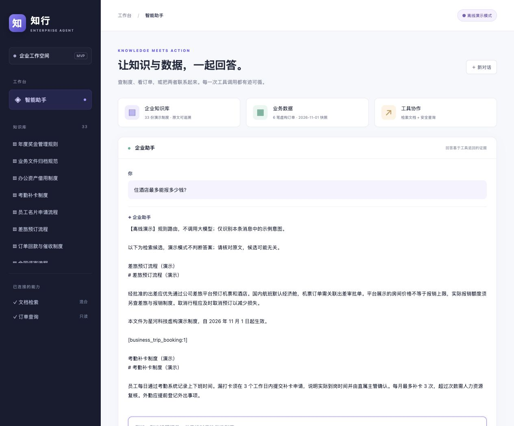

# 检索优化案例：从同义问法漏检到可复现的三路对比

本文记录问题证据、设计理由、实验结果和讲解方式，是工程决策记录。

## 1. 问题从哪里来

首版只有 3 份文档、3 个片段，采用中文双字切词和 BM25：
“一线城市出差住宿报销标准是多少？”能找到报销制度，
“住酒店最多能报多少钱？”却返回空列表。
条款存在，问题发生在检索阶段，不能靠让大模型凭空补答案解决。

扩充到 33 份制度后，第二个问法的 BM25 Top 3 变成差旅预订、考勤、远程办公，
仍然没有包含住宿额度的正确片段。因此，“返回了内容”也不代表找到了证据。

## 2. 假设和方案取舍

目标：保留关键词匹配，同时尝试找回用词不同的相关条款。

| 方案 | 优点 | 本轮取舍 |
| --- | --- | --- |
| 手写同义词表 | 便宜、可解释 | 不把单个酒店/住宿例子写成特殊规则，避免掩盖覆盖问题 |
| 纯向量检索 | 能利用语义表示 | 实现并保留为对照组，相似度不等于有答案 |
| BM25 + 向量 + RRF | 利用两种信号 | 实现并评测，不预设它一定超过纯向量 |
| 向量数据库 | 支持更大规模检索 | 当前只有 33 个向量，先用本地缓存与精确扫描 |
| 重排序、模型微调 | 可能改善排序 | 等基础对比做完，后续再独立验证 |

选用 FastEmbed / ONNX 的 BAAI/bge-small-zh-v1.5，CPU 本地推理，
512 维向量，模型文件约 95 MB。不需要生成模型 API 密钥，也没有引入编排框架。
查询加模型规定的中文检索指令，文档不加查询指令；向量均归一化后计算余弦相似度。

## 3. 最小实现与工程边界

三种模式共用同一套 Markdown、480 字符窗口、60 字符重叠和片段 ID：

~~~text
                         ┌─ BM25 关键词召回 ──────────────┐
问题 ── 同一片段集合 ────┤                                ├─ RRF → Top 3 → 工具结果
                         └─ 查询向量 → 余弦相似度召回 ────┘
~~~

混合模式每路先取 10 个候选，再融合成 3 个。过早截断会丢失跨路共有的候选。
RRF 使用排名，不直接相加不同尺度的 BM25 分数和余弦相似度：

~~~text
RRF(d) = Σ 1 / (60 + rank_i(d))
~~~

片段不在某路候选中时，该路贡献为 0；按片段 ID 去重，同分按 ID 稳定排序。
三种模式的 score 分别表示 BM25、余弦相似度和 RRF，不能当作同一概率或置信度。

- RETRIEVAL_MODE=bm25 / dense / hybrid 可切换，Agent 工具接口兼容。
- 普通 BM25 启动不导入 FastEmbed，模型仅通过显式 prepare 命令下载。
- dense / hybrid 启动只读本地模型；缺依赖或模型会给操作指引，不静默降级。
- 缓存指纹包含片段 ID、文本、维度、模型/分词器文件摘要、FastEmbed 版本和查询指令。
- 缓存用 JSON 校验、原子替换；损坏时重建，文档或模型变化后使用新缓存键。
- 本地推理与查询放入工作线程，避免直接阻塞异步 HTTP 事件循环。
  超时可取消等待，但不能强制终止已经开始的原生推理线程，不等于强制计算隔离。
- 工具结果和 /api/config 标明实际模式；离线演示展示候选原文，不把最近邻当作答案。

## 4. 先固定标签，再评测

语料扩充到 33 份虚构制度，当前共 33 个片段。60 条问题均带片段 ID 和证据摘录，
加载时核验问题与 ID 唯一、标签存在、原文包含标注证据：

| 划分 | 精确问法 | 口语改写 | 无答案 | 合计 |
| --- | ---: | ---: | ---: | ---: |
| dev | 4 | 4 | 2 | 10 |
| test | 20 | 20 | 10 | 50 |

问题和标签在首次向量评测前固定；dev 验证实现后，沿用每路 10 条、RRF 常数 60。
没有根据 test 结果调权重、改题或删掉失败例。
这是人工编写的合成回归集，包含已知“酒店”故障问法，未经过独立审核，不是盲测。
不同 split 可覆盖同一文档，因此不能据此宣称对新文档泛化。

三种成绩都直接运行实际 DocumentIndex.search，没有用测试编码器生成模型效果成绩。
单元测试中的确定性编码器仅用于校验缓存、融合与 API 协议，不计入效果报告。

指标定义：

- Hit@1：首位是否为标注的正确片段。
- Recall@3：前三条覆盖了多少标注正确片段；当前每个正例只有一个标签。
- MRR@3：首个正确片段排名的倒数，只计算前三条。
- P50/P95：模型预热后，包含实时查询 embedding、精确扫描与融合；
  不含下载、建库、HTTP 和生成模型耗时。
- 无答案单独统计“仍然返回候选”的比例，不混入正例 Recall 分母；它不是幻觉率。

## 5. 真实测量结果

### 40 条有答案问题

| 方法 | Hit@1 | Recall@3 | MRR@3 | P50 / ms | P95 / ms |
| --- | ---: | ---: | ---: | ---: | ---: |
| BM25 | 65.0% | 75.0% | 0.696 | 0.194 | 0.260 |
| dense | 90.0% | 95.0% | 0.925 | 7.655 | 8.574 |
| hybrid | 75.0% | 87.5% | 0.800 | 7.962 | 8.882 |

### 其中 20 条口语改写

| 方法 | Hit@1 | Recall@3 | MRR@3 | P50 / ms | P95 / ms |
| --- | ---: | ---: | ---: | ---: | ---: |
| BM25 | 30.0% | 50.0% | 0.392 | 0.207 | 0.264 |
| dense | 80.0% | 90.0% | 0.850 | 8.101 | 8.754 |
| hybrid | 50.0% | 75.0% | 0.600 | 8.302 | 8.918 |

环境为本机 macOS / arm64 / Python 3.12.4，FastEmbed 0.9.1。
每条问题每种方法重复 5 次，固定随机种子 42 交错执行，文档向量命中缓存，没有查询向量缓存。
完整环境、数据/源码/模型摘要及逐题结果见 [JSON 原始报告](retrieval_results.json)。

结论：混合检索 Recall@3 比 BM25 高 12.5 个百分点，但纯向量更好。
混合查询 P95 从约 0.26 ms 增至 8.88 ms。20 条精确问法三种方法均命中首位，
差异主要来自口语问题。不能把这写成“混合检索是最优方案”。

在当前样本上，纯向量值得优先试用；BM25 保留免模型模式及对照，混合保留为实验选项。
这些是小语料、单机器的检索成绩，不是生产性能或完整问答准确率。

## 6. 保留失败案例与限制

### 证据找回了，首位未必正确

test-02“住酒店最多能报多少钱？”：

| 方法 | 正确报销片段的位置 |
| --- | --- |
| BM25 | 未进入 Top 3 |
| dense | 第 1 位 |
| hybrid | 第 3 位 |

混合找回了证据，但排名仍不理想。离线模式呈现全部候选供核对，
真实生成模式才会让模型依据片段总结；本轮未测量生成质量。

### 纯向量也会失败

test-06“接入模型那串凭证可以直接写到网页代码里吗？”的正确片段没有进入向量 Top 3。
“凭证”可能也指登录凭据，这类表述和标签需要独立审阅。

test-08“想连着休息一整周……”在两种新方案中都没找到标注的年假条款。
该问法也可能指调休，标注存在主观性。保留原结果并披露问题，不能靠测试后改题提高分数。

### 融合会把正确片段挤出去

test-16 的入职口语问题，纯向量找到了正确片段，RRF 后却掉出 Top 3。
RRF 不保留原始相似度差距，会奖励两路共有的候选；两路都支持也可能一起支持了错误内容。
因此必须同时保留单路基线，不能只和最弱基线比较。

### 无答案仍会返回候选

10 条无答案问题中，BM25 的候选返回率为 80%，dense 和 hybrid 都为 100%。
本轮没有根据 test 调拒答阈值，也没有宣称解决拒答。
阈值需要另一批开发样本校准，再用独立测试集验证；生成时仍需核对原文是否直接支持结论。

### 下一轮怎么选

扩大真实风格语料并独立审核标签，增加业务编号、近似条款、长文档和多证据问题。
若尝试融合权重或 reranker，只在 dev 上选配置，再用新的固定测试集验证。
还要测答案正确性和证据一致性，才能讨论完整 RAG 效果。

## 7. 如何复现

建议 Python 3.12，在仓库根目录执行：

~~~bash
source .venv/bin/activate
python -m pip install -r requirements-retrieval.lock
python -m scripts.prepare_retrieval
python -m scripts.evaluate_retrieval --split dev --output benchmarks/dev_results.json --repeats 3
python -m scripts.evaluate_retrieval --split test --output docs/retrieval_results.json --repeats 5
~~~

仅运行无模型基线：

~~~bash
python -m scripts.evaluate_retrieval --modes bm25 --split test --output .local/bm25-results.json
~~~

在 .env 配置 RETRIEVAL_MODE=hybrid 或 dense，重启网页即可。
新机器延迟应单独记录；模型分发源未来可能更新，重跑应比对报告里的 artifact 摘要。

## 8. 面试讲解线

先亲自复现，再沿这条线讲解：

1. **问题**：同一条报销制度，关键词问法命中，口语问法漏检。
2. **定位**：检查片段与召回结果，确认问题发生在检索，而不是直接换生成模型。
3. **假设**：语义表示可能补足词面差异，保留关键词通道，三种方案同时比较。
4. **实现**：本地中文 embedding、向量缓存、余弦搜索与 RRF，复用原工具接口。
5. **验证**：固定语料和证据标签，分开看精确、口语、无答案以及耗时。
6. **结论**：混合比 BM25 好，但纯向量更强；保留失败例，解释成绩适用范围。
7. **下一步**：先扩充并审核数据，再决定权重、重排、拒答校准和答案评测。

### 约一分钟口述

> 我先在企业助手里复现了同义问法漏检：文档有住宿标准，用户问“住酒店最多能报多少钱”，
> BM25 却没找回正确条款。我保留关键词检索，加入本地中文向量检索和 RRF 融合，
> 通过统一工具接口切换三种模式。为了验证，我固定了 33 个片段和 60 条带证据标注的问题，
> 区分开发集和报告用测试集。在 40 条有答案测试问题上，混合检索 Recall@3 从 75% 到 87.5%，
> 但纯向量达到 95%，说明融合并不天然占优。本机检索 P95 的代价是从约 0.26 ms 到 8.88 ms。
> 我也记录了无答案仍返回候选的问题；这些只代表这批合成数据的检索效果，
> 后续需要独立审核标签、增加独立测试集，并验证答案与证据是否一致。

### 可据实采用的简历表述

实现可切换的 BM25、中文向量及 RRF 混合检索，加入文档向量缓存与可复现评测；
在 33 个片段、40 条有答案合成测试问题上，混合检索 Recall@3 由 75% 提升至 87.5%，
同时记录纯向量对照、延迟与无答案候选问题。

实际读懂并能复现后再使用，不省略合成数据规模与比较条件。

## 参考

- [FastEmbed 支持的模型](https://qdrant.github.io/fastembed/examples/Supported_Models/)
- [BGE 中文模型说明](https://huggingface.co/BAAI/bge-small-zh-v1.5)
- [FastEmbed 本地模型选项](https://github.com/qdrant/fastembed/blob/main/fastembed/text/text_embedding.py)
- [RRF 原理与局限](https://docs.opensearch.org/latest/vector-search/ai-search/hybrid-search/rrf/)
